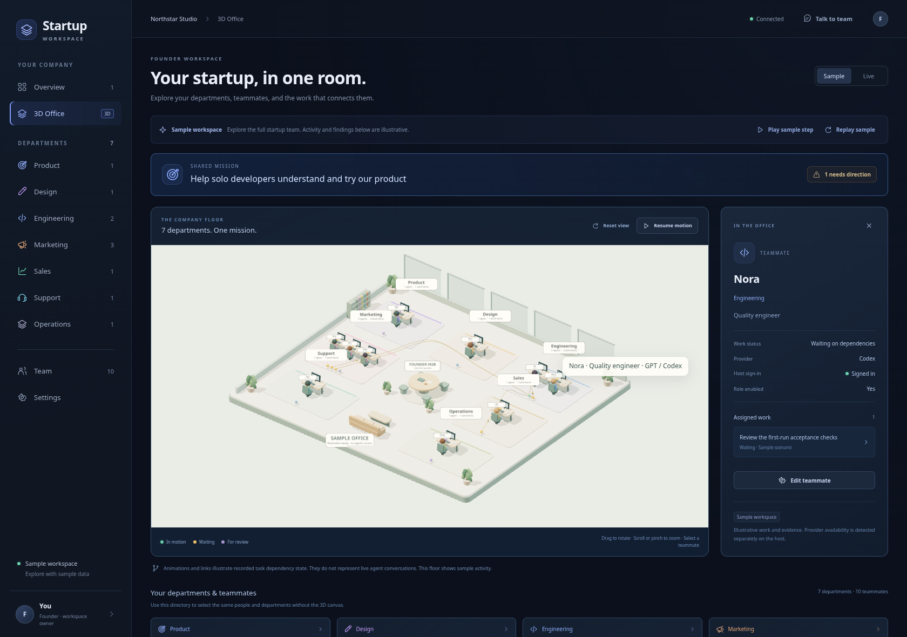

# Startup Workspace

A founder workspace for an AI startup team. Give the company a mission, coordinate engineering and marketing, inspect its work, and provide direction when a task needs a decision.

The first version includes a clearly labeled sample company and a local repository workflow. It is an independent prototype, not a Paperclip fork.



[Marketing department screenshot](docs/screenshots/marketing-preview.png)

[Connected mission view](docs/screenshots/mission-preview.png) · [Artifact workbench](docs/screenshots/workbench-preview.png) · [Recorded timeline](docs/screenshots/timeline-preview.png)

## Run locally

Requires Node.js 22.18 or newer and npm.

```sh
npm ci
npm run dev
```

Vite serves the interface on port 5173 and proxies the local API on port 4174. The launcher stops both processes together. For a production build:

```sh
npm run build
npm start
```

The backend then serves the built interface and API from port 4174. This is a local, single-founder tool; the server does not provide accounts or multi-tenant authentication.

## Founder workflow

- **Company overview:** a visible mission, direction requests, active work, delivered evidence, and proposed next tasks.
- **Mission view:** follow recorded task dependencies across ideas, design, engineering, verification, launch, support, and operations. Inspect what a handoff needs and which work a direction decision affects.
- **3D office:** an interactive view of department spaces, agent desks, task states, and cross-team dependencies. Select a teammate to inspect their assigned work and open its evidence.
- **Departments:** product, design, engineering, marketing, sales, support, and operations, with their own work and agent roles.
- **Shared direction:** answers and mission updates persist across reloads. A mission change holds affected work for reconsideration.
- **Cross-team work:** an engineering delivery creates a QA task in its retained worktree. Other dependent tasks wait for accepted prerequisites. If a downstream job changes an accepted worktree, the earlier delivery returns to review.
- **Team configuration:** assign Claude or Codex to roles, add agents, and import or export a portable team template.
- **Workbench:** inspect task output, captured command results and diffs, changed files in retained worktrees, campaign drafts, and isolated HTML previews.
- **Timeline:** inspect recorded checkpoints of the mission, task states, decisions, and deliverables. Historical views are read-only and do not roll back files or restart work.

Sample tasks, messages, and evidence are labeled as sample data. Replaying the demo advances a scripted example, not a model session. Switching to a connected repository uses actual local observations.

Use **Replay sample** to load the connected demonstration when upgrading an older sample workspace. Live company data is preserved. See [the connected workspace guide](docs/WORKSPACE_VIEWS.md) for the views and their evidence boundaries.

## Create and inspect work

Create a scoped task with a department, an owner, and its prerequisites. New work stays proposed; a task needing direction waits for a founder answer and then still requires an explicit start. Native execution retains its separate opt-in permission.

The mission map draws recorded dependencies. Stage labels organize work; they do not imply that every task passed through every stage. A decision's affected-work view shows which direction gates it can clear and which prerequisites remain. It does not predict customer results or invent different consequences for options the engine treats alike.

The workbench reads changed text files only from the task's validated retained Git worktree. File contents are bounded; escaping symlinks, foreign worktrees, binary files, and credential-like paths are excluded. File inspection refers to the current worktree, while historical views use captured reports and evidence.

An HTML preview can come from a recorded attachment or an eligible changed HTML file. It runs in an opaque browser sandbox with resource fetches, nested frames, forms, and parent workspace access blocked. Inline scripts can provide local interaction. These restrictions do not block every same-frame document navigation. This supports self-contained HTML; previews depending on external assets or a running application server need a separate workflow. Opening a preview does not run repository scripts or establish that the application passed QA.

## Recorded history

Checkpoint recording begins when this version opens the workspace. Existing work receives a baseline; earlier activity is not reconstructed as missing historical snapshots. Checkpoints record successful saved changes, provider transitions, and recovery events, with separate sample and live histories.

History retention is bounded. Older checkpoints may be removed, and large historical output can be clipped with visible capture limitations. Returning to the current workspace shows its latest state; viewing a checkpoint does not change current work. Recorded HTML previews retain their captured version rather than reading a newer file during replay.

## Explore the office

Choose **3D Office** in the company navigation. Drag to orbit the room, scroll or pinch to zoom, and select a teammate or department. The inspector shows the corresponding role, provider, tasks, and evidence. Use **Reset view** to return to the overview angle.

The office reads the same saved workspace as the dashboard. Desk indicators and handoff lines visualize task states and dependencies; animation does not establish that agents exchanged messages or ran a model. Live updates retain the camera position. Motion controls and reduced-motion preferences are supported.

Three.js loads when the office view is opened. Rendering uses local bundled assets and needs WebGL 2. A keyboard-accessible department and teammate directory remains available if the browser cannot render 3D. Leaving the office releases its graphics resources.

## Connect a repository

Open workspace settings and enter the absolute path to an existing local repository on the machine running the server. The inspector reads bounded project documentation and manifests and records Git observations. It does not run installation scripts or tests. Proposals are based on those observations; marketing impact remains a hypothesis until supported by feedback or analytics.

Scheduled inspection can revisit the repository while the server is running. Previous proposals, including dismissed ones, are remembered. Pausing the workspace stops new work. Continuous operation requires keeping the server process running.

This first inspector proposes work from project documentation and setup signals. A general strategy planner, connected customer research, and marketing analytics remain future work.

## Native agent providers

The adapters use Claude Code and Codex CLIs installed and signed in on the server machine. There is no account with a third-party model gateway to create. A laptop login is available only if the CLI is running on that same machine with that login.

The worker host also needs writable CLI runtime storage and access to the provider's endpoints. Sign-in alone does not prove that a job can start. Run `npm run pilot` for local prerequisite checks; `npm run pilot -- --run` explicitly starts one bounded Codex Engineering task and its independent QA handoff, using provider usage. See the [local pilot guide](docs/LOCAL_PILOT.md) for setup and evidence review.

Sign in using each provider's normal CLI flow, then check its status in settings. Provider execution starts disabled. Enable it when ready to run assigned tasks against the connected repository. Runs are serialized and isolated in Git worktrees; a committed, clean repository is required. Failed or interrupted work stays visible, and outputs are offered for review. Accepting a delivery records review status; it does not merge the worktree into your main branch.

Agent reports and recorded command output are separate evidence. An agent's statement that tests passed is not automatically a verified test result. Marketing outputs are drafts; this version does not publish posts, contact leads, or purchase ads.

Founder answers are stored separately from recent conversation and included in subsequent jobs, prioritizing decisions linked to the task. The context is bounded; the prompt reports omitted decisions rather than pretending the complete history is present. The conversation box records founder notes for subsequent jobs; it does not provide an interactive model chat.

## Development checks

```sh
npm test
npm run build
npm run test:e2e
```

Browser tests use Chromium. Set `CHROMIUM_PATH` to its executable if it is not available at `/usr/bin/chromium`. Stop the development server before running browser tests: the suite starts its own server and refuses to reuse an occupied port. Tests use temporary repository fixtures and isolated workspace state; provider tests use subprocess stubs rather than billable model calls.

Workspace data is saved locally in the ignored `.startup-workspace` directory. Set `STARTUP_STATE_DIR` to choose a different location, and `STARTUP_PORT` to change the API port. The Vite proxy uses the same port setting.

## Next milestones

Validate one real mission from proposal through delivery and a founder direction change, then compare founder effort against the equivalent Paperclip workflow. Chat integrations, connected marketing analytics, and broader operating controls can follow that trial.

## License

MIT. See [third-party notices](THIRD_PARTY_NOTICES.md) for the bundled 3D renderer.
